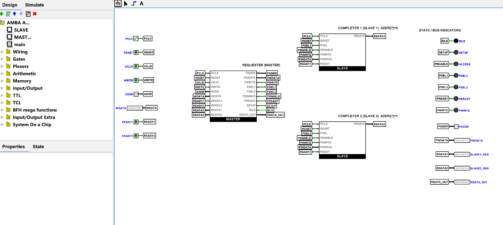
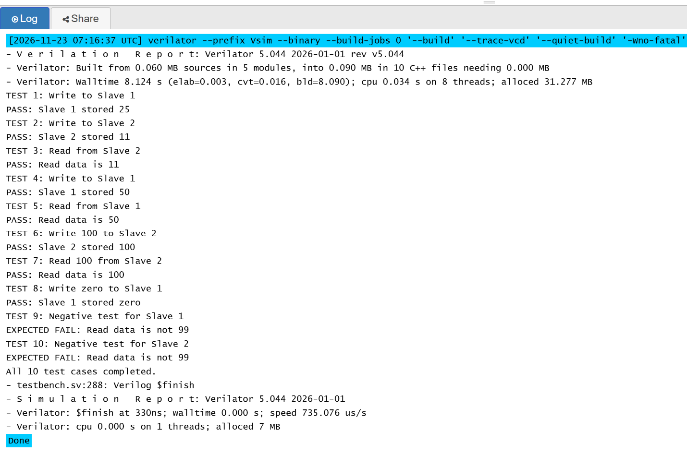
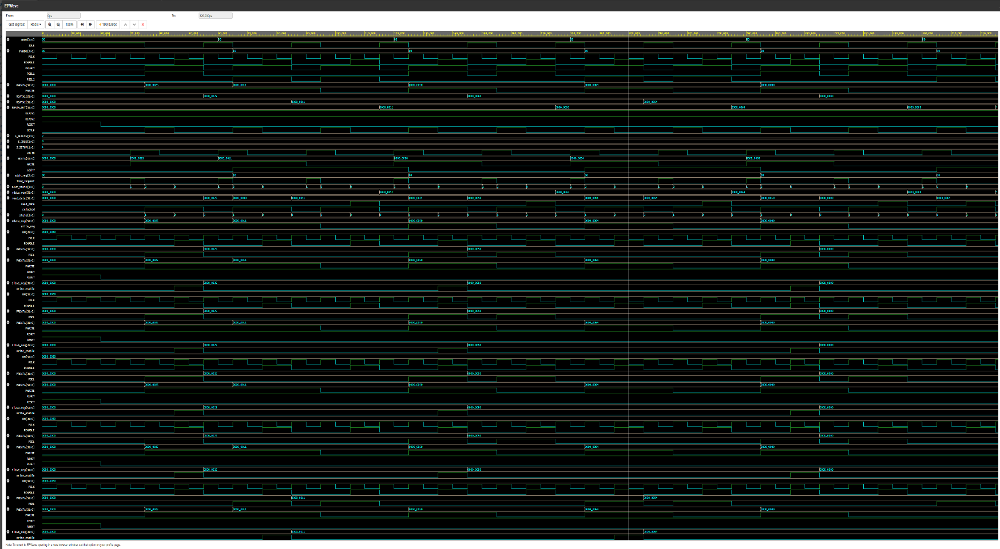

# APB-Style Bus Interface with Two Slaves

## Overview

This project implements an APB-style bus interface that connects a master to two slave modules. The master initiates read and write transactions, while the address is used to select the target slave. The design includes control, address, write-data, read-data, and ready/handshake signals.

The circuit is organized around a **master**, **slave-selection logic**, and **two slave interfaces**. The circuit diagram and simulation waveform are included below.

## Circuit Architecture

The design contains the following main blocks:

- **Master:** Initiates transactions and provides the address, write data, and read/write control.
- **Slave 1 and Slave 2:** Receive transactions when selected and store or return data.
- **Address selection:** The testbench uses `0x00` to access Slave 1 and `0x80` to access Slave 2.
- **Control and handshake signals:** Signals such as `PSEL1`, `PSEL2`, `PENABLE`, `PREADY`, `SETUP`, and `IDLE` coordinate the transaction.
- **Read-data path:** The selected slave's read data is presented through `RDATA_OUT`.

### Circuit Diagram

## Testbench and Verification

A Verilog testbench (`tb`) is used to verify the design. It generates a clock, applies reset, drives transaction inputs, and checks the slave registers and read-data output. The testbench also writes a VCD file (`dump.vcd`) for waveform inspection.

### Test Cases

| Test | Operation | Target | Data / Expected value | Expected result |
|---|---|---|---|---|
| 1 | Write | Slave 1 (`0x00`) | Write `0x25` | Slave 1 register stores `0x25` |
| 2 | Write | Slave 2 (`0x80`) | Write `0x11` | Slave 2 register stores `0x11` |
| 3 | Read | Slave 2 (`0x80`) | Read `0x11` | `RDATA_OUT = 0x11` |
| 4 | Write | Slave 1 (`0x00`) | Write `0x50` | Slave 1 register stores `0x50` |
| 5 | Read | Slave 1 (`0x00`) | Read `0x50` | `RDATA_OUT = 0x50` |
| 6 | Write | Slave 2 (`0x80`) | Write `0x64` (100) | Slave 2 register stores `0x64` |
| 7 | Read | Slave 2 (`0x80`) | Read `0x64` (100) | `RDATA_OUT = 0x64` |
| 8 | Write | Slave 1 (`0x00`) | Write `0x00` | Slave 1 register stores zero |
| 9 | Negative read check | Slave 1 (`0x00`) | Compare read data against `0x99` | Expected failure: actual data is not `0x99` |
| 10 | Negative read check | Slave 2 (`0x80`) | Compare read data against `0x99` | Expected failure: actual data is not `0x99` |

**Note:** Tests 9 and 10 are intentional negative checks. They compare the returned read data with an incorrect expected value (`0x99`), so the testbench reports `EXPECTED FAIL`. These messages are expected and demonstrate that the comparison detects a mismatch; they do not indicate an unexpected design failure.

### Testbench Output

The simulation output shows that Tests 1–8 pass, while Tests 9 and 10 produce the intended mismatch messages. The testbench then reports that all 10 test cases have completed.

## Simulation Waveform

The waveform can be used to inspect the clock, reset, address, write data, read data, slave-select, enable, ready, and other control signals across the transactions.

## Main Signals

| Signal | Description |
|---|---|
| `PCLK` | Bus clock |
| `RESET` | Reset input |
| `ADDR` | Master-side address input |
| `PADDR` | Address presented on the bus |
| `WDATA` | Master-side write-data input |
| `PWDATA` | Write data presented on the bus |
| `WRITE` / `PWRITE` | Read/write control |
| `VALID` | Indicates a request from the master |
| `PSEL1`, `PSEL2` | Select Slave 1 or Slave 2 |
| `PENABLE` | Transfer enable control |
| `PREADY` | Ready/handshake indication |
| `RDATA_OUT` | Read data returned by the selected slave |
| `READY1`, `READY2` | Ready inputs for the respective slaves |

## Running the Simulation

1. Open the project in your Verilog simulation environment.
2. Compile the RTL files together with the testbench.
3. Run the testbench module `tb`.
4. Review the console output to check the PASS and EXPECTED FAIL messages.
5. Open `dump.vcd` in a waveform viewer to inspect signal transitions.

## Verification Summary

- **10 test cases** are included in the testbench.
- **8 functional checks** cover writes, reads, and writing zero to the two slaves.
- **2 negative checks** intentionally compare the read data against an incorrect value.
- The supplied simulation output shows the functional checks passing and the two negative checks reporting the expected mismatches.

